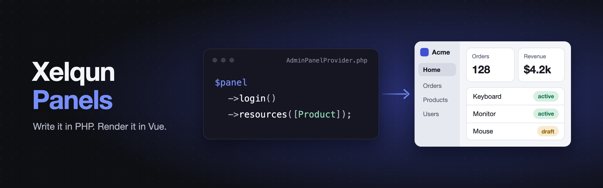

<p align="center">
    
</p>

<p align="center">
    <a href="https://packagist.org/packages/xelqun/panels"></a>
    <a href="https://www.npmjs.com/package/@xelqun/panels"></a>
    <a href="https://packagist.org/packages/xelqun/panels/stats"></a>
</p>

Describe an admin panel in PHP and generic Vue components render it, with navigation, authentication, CRUD pages and dashboards. Normal panels need no Vue at all.

> **Alpha:** the API will change. Requires Laravel 13, Inertia 3, Vue 3.5, Tailwind 4, [`xelqun/forms`](https://github.com/199ocero/xelqun-forms) and [`xelqun/tables`](https://github.com/199ocero/xelqun-tables).

## Installation

```bash
composer require xelqun/panels
php artisan xelqun-panels:install
php artisan make:xelqun-panel Admin
```

Then add `PanelUser` to your user model, as the [installation guide](https://xelqun.com/panels/installation) shows. Nobody can sign in until you do.

## Documentation

Everything else is in the docs at **[xelqun.com/panels](https://xelqun.com/panels)**. You can also try the [demo](https://demo.xelqun.com).

## License

MIT
